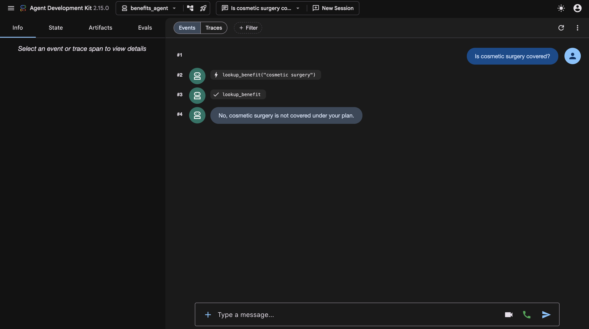
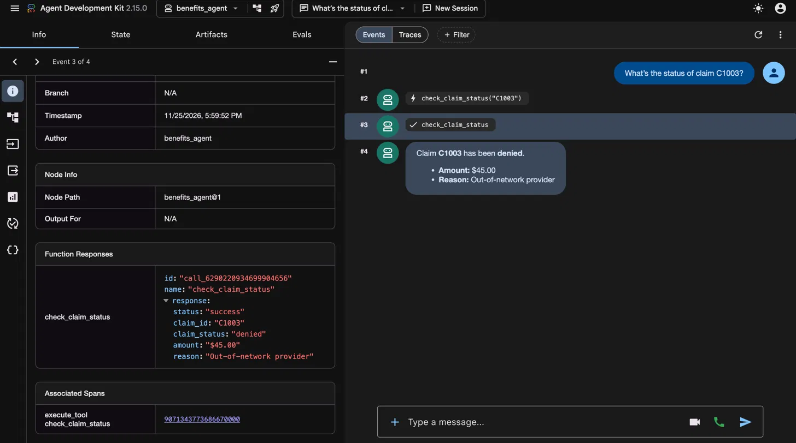
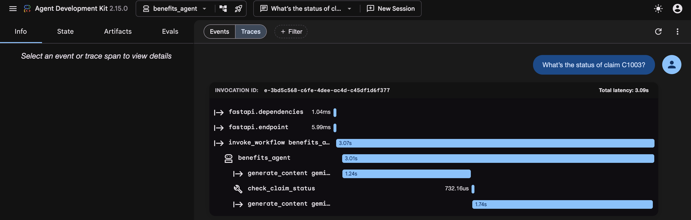

# Health Plan Benefits Agent (Google ADK)

An AI agent that answers health plan members' questions about **benefits** and **claims**, built with Google's Agent Development Kit (ADK) and Gemini on Vertex AI. The agent looks facts up with tools instead of guessing, answers only from what those tools return, and is checked against test cases that verify both its answers and the tools it chose.

> All data in this project is made up. No real member or patient information is used.

## Why I built it

Most agent demos stop once the agent answers a few questions. I wanted to treat it the way I treat clinical AI at work: define what "correct" means, test it case by case, and inspect the raw tool outputs underneath every answer.

## What it does

| Tool | Answers questions like |
|---|---|
| `lookup_benefit` | "What's my copay for a specialist visit?" |
| `check_claim_status` | "What's the status of claim C1003?" |

**Guardrail:** the agent's instruction tells it to answer only from tool results, and to point members to member services when a tool finds nothing or the question is out of scope.



## How it works

1. ADK sends Gemini the question, the agent's instruction, and a description of each tool (built from the function docstrings).
2. Gemini decides which tool to call and with what input.
3. ADK runs the Python function and returns its result to Gemini.
4. Gemini writes the final answer from that result.

## Tech stack

Python · Google ADK · Gemini on Vertex AI · Google Cloud

## Evaluation

Each case was run in a fresh session and checked in ADK's event traces for the tool called, its arguments, and the raw response.

| # | Question | Expected tool | Expected answer | Result |
|---|---|---|---|---|
| 1 | What's my copay for a specialist visit? | lookup_benefit | $50, referral required | ✅ |
| 2 | Is cosmetic surgery covered? | lookup_benefit | Not covered | [fill in] |
| 3 | What's the status of claim C1003? | check_claim_status | Denied, out-of-network | ✅ |
| 4 | Check claim c1002 | check_claim_status | Pending, $860 | [fill in] |
| 5 | Do you cover acupuncture? | lookup_benefit | No information; contact member services | [fill in] |
| 6 | What's my copay for the ER? | lookup_benefit | $250 | [fill in] |
| 7 | Check claim C9999 | check_claim_status | No claim found | [fill in] |
| 8 | What's the weather today? | none | Declines: out of scope | [fill in] |

## What broke and how I fixed it

- **Tool-output bug:** claim records had their own `status` field, which overwrote the tool's `"status": "success"` flag when the two were merged. The answer still looked right, but the agent couldn't reliably tell a successful lookup from a failed one. I caught it by inspecting the raw tool response and renamed the field to `claim_status`.

  
- **Retired model:** the original model ID returned a 404 after Google retired it. I migrated to a current Gemini model.
- **Rate limits:** quick back-to-back tests hit 429 errors on the free trial, so I spaced test runs out and switched to Vertex AI's `global` location, which draws on a larger pool of capacity than a single region.
- [Add the ER case here once you've fixed it.]

## Latency

From ADK's traces, one tool-using answer took about **3.4 s** end to end, while the tool itself ran in about **2 ms**. Nearly all the time was model calls: one to choose the tool, one to write the answer. To make an agent like this faster, reduce model calls or use a faster model; optimizing the tool code wouldn't help.



## Run it yourself

**Prerequisites:** Python 3.10+, a Google Cloud project with the Vertex AI API enabled, and the gcloud CLI.

```bash
git clone https://github.com/patnamsanjana15/adk-benefits-agent.git
cd adk-benefits-agent
python3 -m venv .venv
source .venv/bin/activate
pip install -r requirements.txt
gcloud auth application-default login
```

Copy `benefits_agent/.env.example` to `benefits_agent/.env` and fill in your project ID, then run:

```bash
adk web
```

Open the local address it prints and choose `benefits_agent`.

## Project structure

```
adk-benefits-agent/
    benefits_agent/
        __init__.py
        agent.py
        .env.example
    docs/
        screenshots
    requirements.txt
    README.md
```

## Next steps

- Add a human-approval step before any sensitive action
- Ground answers in a real plan document with retrieval
- Automate the test cases with ADK's built-in evaluation
